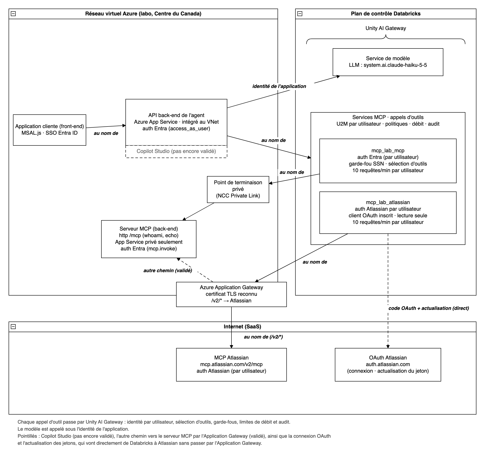

# Identité utilisateur déléguée pour les outils d'agent avec Databricks Unity AI Gateway (preuve de concept)

*English version: [README.md](README.md)*

Cette preuve de concept montre une application d'agent hébergée dans Azure qui authentifie les utilisateurs avec Microsoft Entra ID, appelle des outils MCP **au nom de l'utilisateur connecté** par l'entremise de Databricks Unity AI Gateway, et appelle un grand modèle de langage **sous sa propre identité d'application**. Unity AI Gateway applique la sélection d'outils, les garde-fous, les limites de débit et l'audit à chaque appel d'outil.

Elle a été construite et testée dans un laboratoire Azure (Centre du Canada), avec des données synthétiques seulement. Les résultats de validation, les points ouverts et les prérequis sont résumés dans [docs/lab-results.fr.md](docs/lab-results.fr.md).

## Ce que la preuve de concept démontre

- **Une seule connexion Entra** dans une application d'agent hébergée sur Azure App Service (SPA avec MSAL.js, back-end FastAPI).
- **Les outils au nom de l'utilisateur.** Le back-end échange le jeton de l'utilisateur contre un jeton Azure Databricks (flux On-Behalf-Of d'Entra), puis appelle les services MCP d'Unity AI Gateway. La fédération de jetons OAuth est l'autre approche testée (`client/tokens.py`, `exchange_for_databricks_token`).
- **Le LLM sous l'identité de l'application.** Le principal de service du back-end (informations d'identification du client) appelle un service de modèle d'Unity AI Gateway.
- **Deux services MCP, tous deux en OAuth U2M Per User**, pour que le jeton propre à chaque utilisateur se rende à chaque serveur MCP :
  - un serveur MCP protégé par Entra sur App Service, sans accès public, joint depuis le calcul sans serveur de Databricks par un point de terminaison privé (NCC);
  - le serveur Rovo MCP d'Atlassian, joint par une Azure Application Gateway (`/v2/*` acheminé vers `mcp.atlassian.com`).
- **La gouvernance au gateway :** sélection d'outils (les outils non sélectionnés sont masqués et refusés), politique de garde-fou qui bloque un numéro de sécurité sociale américain, limites de débit par utilisateur, et traces d'utilisation et d'audit (`system.ai_gateway.usage`).
- **L'expérience de connexion :**
  - La connexion aux outils Entra est **silencieuse**. L'application exécute le flux de code d'autorisation avec `prompt=none` et remet le code à Databricks par l'API d'informations d'identification (Bêta).
  - La fenêtre contextuelle de connexion Atlassian s'ouvre d'elle-même quand l'utilisateur n'est pas connecté. Si le navigateur la bloque, elle s'ouvre au prochain message de l'utilisateur.
  - **Sign out** efface les témoins et le stockage de l'application et ferme la session Microsoft. **Disconnect tools** retire les connexions aux outils que conserve Unity AI Gateway (API d'informations d'identification, Bêta).

## Architecture



La variante avec fédération de jetons pour l'entrée est illustrée dans [docs/architecture-federation.fr.png](docs/architecture-federation.fr.png).

## Contenu du dépôt

| Chemin | Contenu |
|---|---|
| `agent_app/` | L'application d'agent. `web.py` (API : configuration de connexion, clavardage, outils, connexion et déconnexion), `agent.py` (boucle d'appels d'outils), `llm.py` (client du service de modèle), `mcp_session.py` et `mcp_router.py` (une session MCP par service, routage selon le nom de l'outil), `credentials.py` (connexion et déconnexion des informations d'identification par utilisateur, API Bêta), `static/` (SPA avec MSAL.js inclus). |
| `mcp_server/` | Le serveur MCP d'exemple protégé par Entra (outils `whoami` et `echo`). `auth.py` valide l'émetteur, l'audience et l'étendue `mcp.invoke`. |
| `client/` | Un client de test en ligne de commande : jetons (OBO et échange par fédération), client JSON-RPC MCP, exécution des tests. |
| `infra/` | Scripts de provisionnement, à exécuter dans l'ordre numérique (voir *Déployer*). `lab_payloads.py` construit les définitions de la connexion Unity Catalog et des services MCP. |
| `infra/spike_agw/` | Réseau virtuel, point de terminaison privé, Application Gateway, certificat Let's Encrypt et route vers Atlassian. |
| `tests/` | Tests unitaires (pytest, sans réseau) : 172 tests. |
| `docs/` | Diagrammes d'architecture et document de résultats (anglais et français). |

## Prérequis

- Un abonnement Azure où vous pouvez créer des groupes de ressources, App Service, du réseau et une Application Gateway.
- Des droits Microsoft Entra pour créer des inscriptions d'application, et idéalement un administrateur du locataire qui peut accorder le consentement administrateur.
- Databricks : des droits d'administrateur de compte (configuration de connectivité réseau, principaux de service, politique de fédération facultative), un espace de travail dans une région qui offre Model Serving, et des droits Unity Catalog pour créer un catalogue, un schéma, des connexions et des services MCP. Les appelants ont besoin de `EXECUTE` sur les services MCP et sur le service de modèle.
- Pour le volet Atlassian : un site Atlassian Cloud, et un administrateur d'organisation qui peut autoriser vos domaines pour le serveur MCP d'Atlassian.
- Outils locaux : `az`, la CLI `databricks` (un profil de compte et un profil d'espace de travail), `uv`, `openssl`, `certbot` (scripts Let's Encrypt).

## Configurer

- Copiez `.lab.env.example` vers `.lab.env` et réglez `MCP_SERVICE_NAME`. Les scripts écrivent les autres valeurs au fil de l'exécution (chaque bloc indique quel script).
- Les secrets vont uniquement dans `.lab.secrets`, que les scripts créent avec le mode 600 : `BACKEND_CLIENT_SECRET`, `MCP_API_CLIENT_SECRET`, `UC_CONN_CLIENT_SECRET`, `ATLASSIAN_CLIENT_SECRET`, `AGW_PFX_PASSWORD`. Les deux fichiers sont exclus de git. Ne les versionnez jamais.
- Les scripts contiennent des valeurs à remplacer, comme `<your-cli-account-profile>`, `<your-cli-workspace-profile>`, `<TENANT_ID>`, `<SUBSCRIPTION_ID>`, `<your-tenant>` et `<unified-login-host>`. Remplacez-les par vos valeurs, et lisez chaque script avant de l'exécuter : ils créent des ressources facturables.
- Noms du laboratoire : catalogue `mcp_obo_lab`, schéma `mcp`, services `mcp_lab_mcp` et `mcp_lab_atlassian`. Renommez-les de façon cohérente si vous préférez les vôtres.

## Déployer

À partir de la racine du dépôt, dans cet ordre :

| Étape | Script | Rôle |
|---|---|---|
| 1 | `infra/00_workspace.sh` | Groupe de ressources et espace de travail Azure Databricks sans serveur. |
| 2 | `infra/10_entra.sh` | Inscriptions d'application Entra : SPA front-end, API back-end de l'agent, API MCP (`mcp.invoke`). |
| 3 | `infra/15_uc_conn_app.sh` | Une application Entra distincte, client OAuth de la connexion Unity Catalog. |
| 4 | `infra/20_mcp_app.sh` | Déploie le serveur MCP d'exemple sur App Service. |
| 5 | `infra/25_mcp_service.sh` | Connexion HTTP Unity Catalog (OAuth U2M Per User) et service MCP avec sélection d'outils et limites de débit. Ajoutez la politique de garde-fou dans l'interface du service MCP. |
| 6 | `infra/40_private_endpoint.sh` | Configuration de connectivité réseau, règle de point de terminaison privé vers l'App Service MCP, approbation. |
| 7 | `infra/41_public_access.sh disable` | Désactive l'accès public à l'App Service MCP (refuse tant que le point de terminaison privé n'est pas établi). |
| 8 | `infra/spike_agw/50_*` à `56_*` | Réseau virtuel et point de terminaison privé, Application Gateway, certificat Let's Encrypt, et route `/v2/*` vers Atlassian avec journaux d'accès. |
| 9 | `infra/60_agent_identity.sh` | Inscrit l'application back-end comme principal de service Databricks, accorde le droit d'accès à l'espace de travail, vérifie un appel au modèle. |
| 10 | `infra/61_agent_app.sh` | Déploie l'application d'agent sur App Service (intégration au réseau virtuel, NAT, paramètres, URI de redirection). |
| 11 | `infra/70_atlassian_client.sh`, `infra/71_atlassian_mcp_service.sh` | Inscrit un client OAuth auprès d'Atlassian, puis la connexion Atlassian (hôte = l'Application Gateway) et le service MCP. Passez à `71` la liste des outils en lecture seule pour la sélection d'outils. |

`infra/30_federation.sh` sert seulement à la variante avec fédération de jetons. `infra/99_teardown.sh` retire tout (voir *Nettoyer*).

## Essayer

1. Ouvrez l'application d'agent et cliquez sur **Sign in**. Le panneau d'identité montre `tools_as` = vous et `llm_as` = l'application.
2. La connexion aux outils Entra se fait en silence. La fenêtre contextuelle de connexion Atlassian s'ouvre; choisissez votre site et acceptez une fois.
3. Demandez *« Who am I? »* : le serveur MCP renvoie vos revendications Entra (audience = l'API MCP).
4. Demandez *« Please echo exactly: Customer SSN is 123-45-6789 »* : bloqué par le garde-fou (`-32003`).
5. Dans le panneau de débogage, appelez `admin_reset` : refusé par la sélection d'outils (`-32003`).
6. Demandez *« What Jira issues are in project LAB? »* : Atlassian par l'Application Gateway, en tant que votre utilisateur Atlassian.
7. Interrogez `system.ai_gateway.usage` : les appels MCP montrent votre utilisateur (`USER`), les appels au modèle montrent l'application (`SERVICE_PRINCIPAL`).
8. Cliquez sur **Disconnect tools** et rechargez pour revivre la première connexion.

## Exécuter les tests

```
uv sync
uv run pytest
```

## Variantes

- **Fédération de jetons au lieu de l'OBO.** La politique de fédération du compte (`30_federation.sh`) accepte le jeton de l'utilisateur pour l'API back-end, et le back-end l'échange à `/oidc/v1/token` (sans `client_id`, étendue `all-apis`). Le back-end n'a alors plus besoin d'autorisation déléguée vers Azure Databricks, ni du consentement qui va avec. Dans le laboratoire, l'échange et les appels au gateway ont été validés avec une politique pour l'audience Azure Databricks.
- **Connexion Atlassian par redirection au lieu d'une fenêtre contextuelle.** Ajoutez une entrée avec `"prompt": "consent"` pour le service Atlassian à `TOOL_SIGNIN_JSON` (modèle dans `61_agent_app.sh`), et inscrivez le client Atlassian avec le `/tools-callback` de l'application (`70_atlassian_client.sh` l'ajoute quand `AGENT_APP_URL` est défini). L'organisation Atlassian qui gère les comptes de vos utilisateurs doit autoriser le domaine de l'application dans *Atlassian Administration > Connectors > Atlassian MCP server > Domains*.
- **Points de terminaison OAuth d'Atlassian par l'Application Gateway.** Acheminez `/authorize` et `/oauth/*` vers `auth.atlassian.com` (remplacement du nom d'hôte), et pointez `authorization_endpoint` et `token_endpoint` de la connexion vers la passerelle. L'échange de jeton sort alors par la passerelle. Les pages de connexion et de consentement se chargent quand même directement depuis Atlassian dans le navigateur. Restreignez les sources de l'écouteur si vous faites ce choix.

## Pièges connus

- L'écouteur de l'Application Gateway doit présenter un **certificat reconnu publiquement**. Un certificat autosigné ou émis par une autorité de certification privée échoue.
- Utilisez une **application Entra distincte** comme client OAuth de la connexion Unity Catalog. Réutiliser l'application de l'API MCP fait échouer l'actualisation des jetons (AADSTS90009).
- Réglez le `mcp_resource` de la connexion sur l'URI d'ID d'application en `https://` de l'API MCP, sinon la connexion échoue avec AADSTS9010010.
- Enregistrez **les deux URI de redirection** sur le client OAuth de la connexion : l'hôte de l'espace de travail et l'hôte de connexion du compte, chacun avec `/login/oauth/http.html`.
- La page de connexion du gateway doit s'ouvrir dans une **fenêtre contextuelle**. Une redirection pleine page complète le consentement, mais n'enregistre aucune information d'identification.
- Les appelants ont besoin d'un **droit d'accès à l'espace de travail** (par exemple Workspace access), sinon le gateway renvoie HTTP 403.
- Le back-end a besoin du **consentement** pour son autorisation déléguée vers Azure Databricks (AADSTS65001 tant qu'il n'est pas accordé). Le consentement administrateur du locataire retire cette demande pour tout le monde.
- La **liste d'adresses IP autorisées d'Atlassian** s'applique aux appels de données MCP (l'adresse IP de sortie de l'Application Gateway). La connexion et l'échange de jeton n'ont pas été bloqués dans notre test.
- La **recherche Jira** exige une requête JQL bornée (par exemple un projet ou une date). Unity AI Gateway renvoie un message générique « external MCP tool failed » quand le fournisseur signale une erreur.
- **Remplacer un client OAuth** invalide toutes les informations d'identification par utilisateur, jusqu'à ce que chaque utilisateur se reconnecte.
- Après le retrait d'informations d'identification, le gateway peut continuer à les utiliser pendant quelques minutes.
- **Restreignez l'écouteur de l'Application Gateway** (NSG ou WAF). Un écouteur public qui relaie vers Atlassian est accessible à tous.

## Nettoyer

`infra/99_teardown.sh` supprime les services MCP, les connexions, le catalogue, le principal de service et le groupe de ressources. Il affiche les étapes manuelles restantes : les inscriptions d'application Entra, le client OAuth Atlassian et les fichiers de secrets locaux.

## Avertissement

Code d'exemple fourni tel quel, sans garantie d'aucune sorte, à des fins d'apprentissage et de discussion. Il n'est pas prêt pour la production. Les API d'informations d'identification utilisées pour la connexion et la déconnexion pilotées par l'application sont en Bêta et peuvent changer. Révisez la gestion de l'identité, du réseau, de la journalisation et des secrets selon vos propres normes avant d'en réutiliser une partie.

## Licence

Licence Apache 2.0, voir [LICENSE](LICENSE). MSAL.js, inclus dans le dépôt, est sous licence MIT, voir [THIRD_PARTY_NOTICES.md](THIRD_PARTY_NOTICES.md).
