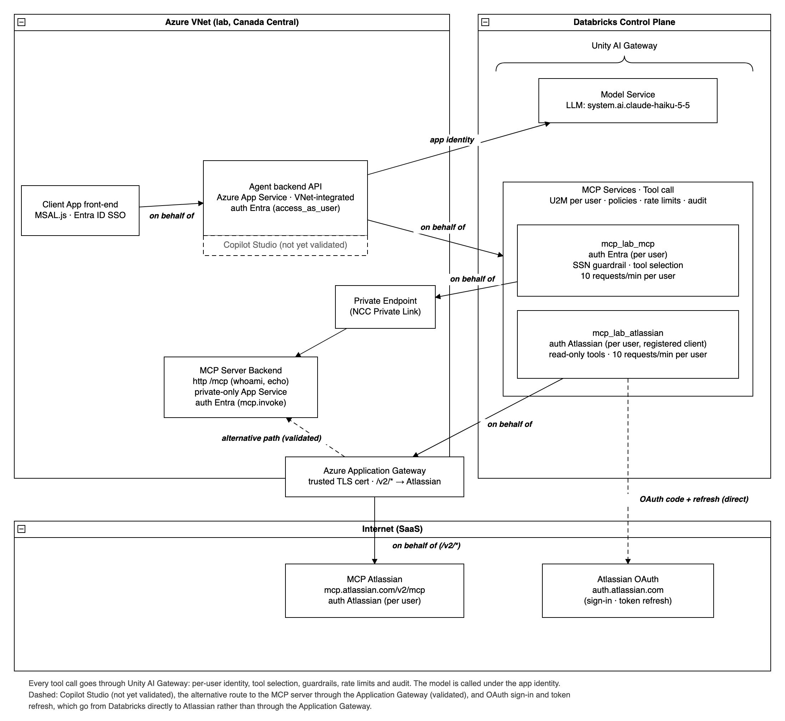

# Delegated user identity for agent tools with Databricks Unity AI Gateway (POC)

*Version française : [README.fr.md](README.fr.md)*

This proof of concept shows an Azure-hosted agent application that signs users in with Microsoft Entra ID, calls MCP tools **on behalf of the signed-in user** through Databricks Unity AI Gateway, and calls a large language model **under its own application identity**. Unity AI Gateway enforces tool selection, guardrails, rate limits and audit on every tool call.

It was built and tested in an Azure lab (Canada Central) with synthetic data only. The validation results, open items and prerequisites are summarized in [docs/lab-results.en.md](docs/lab-results.en.md).

## What it demonstrates

- **One Entra sign-in** in an agent app hosted on Azure App Service (browser SPA with MSAL.js, FastAPI backend).
- **Tools as the user.** The backend exchanges the user's token for an Azure Databricks token (Entra on-behalf-of) and calls Unity AI Gateway MCP services. OAuth token federation is the tested alternative (`client/tokens.py`, `exchange_for_databricks_token`).
- **LLM as the application.** The backend's service principal (client credentials) calls a Unity AI Gateway model service.
- **Two MCP services, both OAuth U2M Per User**, so each user's own token reaches each MCP server:
  - an Entra-protected MCP server on App Service with public access disabled, reached from Databricks serverless compute through an NCC private endpoint;
  - Atlassian's Rovo MCP server, reached through an Azure Application Gateway (`/v2/*` routed to `mcp.atlassian.com`).
- **Governance at the gateway:** tool selection (unlisted tools are hidden and rejected), a guardrail policy that blocks a US Social Security Number, per-user rate limits, and usage and audit records (`system.ai_gateway.usage`).
- **Sign-in experience:**
  - Entra tool sign-in is **silent**. The app runs the authorization code flow with `prompt=none` and hands the code to Databricks through the credential API (Beta).
  - The Atlassian sign-in pop-up opens automatically when the user isn't signed in. If the browser blocks it, it opens with the user's next message.
  - **Sign out** clears the app's cookies and storage and ends the Microsoft session. **Disconnect tools** removes the user's tool sign-ins held by Unity AI Gateway (credential API, Beta).

## Architecture



The token federation variant of the inbound hop is shown in [docs/architecture-federation.en.png](docs/architecture-federation.en.png).

## Repository layout

| Path | Contents |
|---|---|
| `agent_app/` | The agent app. `web.py` (API: sign-in config, chat, tools, sign-in and sign-out endpoints), `agent.py` (tool-calling loop), `llm.py` (model service client), `mcp_session.py` and `mcp_router.py` (one MCP session per service, routing by tool name), `credentials.py` (per-user credential sign-in and sign-out, Beta API), `static/` (SPA with vendored MSAL.js). |
| `mcp_server/` | The sample Entra-protected MCP server (tools `whoami` and `echo`). `auth.py` validates issuer, audience and the `mcp.invoke` scope. |
| `client/` | A command-line test client: token helpers (OBO and federation exchange), MCP JSON-RPC client, test runner. |
| `infra/` | Provisioning scripts, run in numeric order (see *Deploy*). `lab_payloads.py` builds the Unity Catalog connection and MCP service payloads. |
| `infra/spike_agw/` | VNet, private endpoint, Application Gateway, Let's Encrypt certificate and the Atlassian route. |
| `tests/` | Unit tests (pytest, no network): 172 tests. |
| `docs/` | Architecture diagrams and the results brief (English and French). |

## Prerequisites

- An Azure subscription where you can create resource groups, App Service, networking and an Application Gateway.
- Microsoft Entra rights to create app registrations, and ideally a tenant admin who can grant admin consent.
- Databricks: account admin rights (network connectivity configuration, service principals, optional federation policy), a workspace in a region with Model Serving, and Unity Catalog rights to create a catalog, schema, connections and MCP services. Callers need `EXECUTE` on the MCP services and on the model service.
- For the Atlassian leg: an Atlassian Cloud site and an organization admin who can allow your domains for the Atlassian MCP server.
- Local tools: `az`, the `databricks` CLI (one account-level and one workspace-level profile), `uv`, `openssl`, `certbot` (Let's Encrypt scripts).

## Configure

- Copy `.lab.env.example` to `.lab.env` and set `MCP_SERVICE_NAME`. The scripts write the other values as they run (each block says which script).
- Secrets go only in `.lab.secrets`, which the scripts create with mode 600: `BACKEND_CLIENT_SECRET`, `MCP_API_CLIENT_SECRET`, `UC_CONN_CLIENT_SECRET`, `ATLASSIAN_CLIENT_SECRET`, `AGW_PFX_PASSWORD`. Both files are git-ignored. Never commit them.
- The scripts contain placeholders such as `<your-cli-account-profile>`, `<your-cli-workspace-profile>`, `<TENANT_ID>`, `<SUBSCRIPTION_ID>`, `<your-tenant>` and `<unified-login-host>`. Replace them with your values, and read each script before running it: they create billable resources.
- Lab names: catalog `mcp_obo_lab`, schema `mcp`, services `mcp_lab_mcp` and `mcp_lab_atlassian`. Rename them consistently if you prefer your own.

## Deploy

Run from the repository root, in this order:

| Step | Script | What it does |
|---|---|---|
| 1 | `infra/00_workspace.sh` | Resource group and a serverless Azure Databricks workspace. |
| 2 | `infra/10_entra.sh` | Entra app registrations: front-end SPA, agent backend API, MCP API (`mcp.invoke`). |
| 3 | `infra/15_uc_conn_app.sh` | A separate Entra app used as the Unity Catalog connection's OAuth client. |
| 4 | `infra/20_mcp_app.sh` | Deploys the sample MCP server to App Service. |
| 5 | `infra/25_mcp_service.sh` | Unity Catalog HTTP connection (OAuth U2M Per User) and MCP service with tool selection and rate limits. Add the guardrail policy in the MCP service's UI. |
| 6 | `infra/40_private_endpoint.sh` | Network connectivity configuration, private endpoint rule to the MCP App Service, approval. |
| 7 | `infra/41_public_access.sh disable` | Turns off public access on the MCP App Service (refuses unless the private endpoint is established). |
| 8 | `infra/spike_agw/50_*` to `56_*` | VNet and private endpoint, Application Gateway, Let's Encrypt certificate, and the `/v2/*` route to Atlassian with access logs. |
| 9 | `infra/60_agent_identity.sh` | Registers the backend app as a Databricks service principal, grants the workspace entitlement, checks a model call. |
| 10 | `infra/61_agent_app.sh` | Deploys the agent app to App Service (VNet integration, NAT, app settings, redirect URIs). |
| 11 | `infra/70_atlassian_client.sh`, `infra/71_atlassian_mcp_service.sh` | Registers an OAuth client with Atlassian, then the Atlassian connection (host = the Application Gateway) and MCP service. Pass the read-only tool list to `71` to set tool selection. |

`infra/30_federation.sh` is only needed for the token federation variant. `infra/99_teardown.sh` removes everything (see *Clean up*).

## Try it

1. Open the agent app and **Sign in**. The identity panel shows `tools_as` = you and `llm_as` = the app.
2. Entra tool sign-in happens silently. The Atlassian sign-in pop-up opens; pick your site and accept once.
3. Ask *"Who am I?"*: the MCP server returns your Entra claims (audience = the MCP API).
4. Ask *"Please echo exactly: Customer SSN is 123-45-6789"*: blocked by the guardrail (`-32003`).
5. In the debug panel, call `admin_reset`: rejected by tool selection (`-32003`).
6. Ask *"What Jira issues are in project LAB?"*: Atlassian through the Application Gateway, as your Atlassian user.
7. Query `system.ai_gateway.usage`: MCP calls show your user (`USER`), model calls show the app (`SERVICE_PRINCIPAL`).
8. **Disconnect tools** and reload to replay the first-time experience.

## Run the tests

```
uv sync
uv run pytest
```

## Variations

- **Token federation instead of OBO.** The account federation policy (`30_federation.sh`) accepts the user's token for the backend API, and the backend exchanges it at `/oidc/v1/token` (no `client_id`, scope `all-apis`). This removes the backend's delegated permission to Azure Databricks and its consent step. In the lab, the exchange and gateway calls were validated with a policy for the Azure Databricks audience.
- **Atlassian sign-in by redirect instead of pop-up.** Add an entry with `"prompt": "consent"` for the Atlassian service to `TOOL_SIGNIN_JSON` (template in `61_agent_app.sh`), and register the Atlassian client with the app's `/tools-callback` (`70_atlassian_client.sh` adds it when `AGENT_APP_URL` is set). The Atlassian organization that manages your users' accounts must allow the app's domain under *Atlassian Administration > Connectors > Atlassian MCP server > Domains*.
- **Atlassian OAuth endpoints through the Application Gateway.** Route `/authorize` and `/oauth/*` to `auth.atlassian.com` (host-name override), and set the connection's `authorization_endpoint` and `token_endpoint` to the gateway. The token exchange then leaves through the gateway. The browser's login and consent pages still load directly from Atlassian. Restrict the listener's sources if you do this.

## Known gotchas

- The Application Gateway listener must present a **publicly trusted certificate**. A self-signed or private-CA certificate fails.
- Use a **separate Entra app** as the Unity Catalog connection's OAuth client. Reusing the MCP API app makes token refresh fail (AADSTS90009).
- Set the connection's `mcp_resource` to the MCP API's `https://` Application ID URI, or sign-in fails with AADSTS9010010.
- Register **both redirect URIs** on the connection's OAuth client: the workspace host and the account login host, each with `/login/oauth/http.html`.
- The gateway's sign-in page must be opened in a **pop-up**. A full-page redirect completes consent but stores no credential.
- Callers need a **workspace entitlement** (for example Workspace access), or the gateway returns HTTP 403.
- The backend needs **consent** for its delegated permission to Azure Databricks (AADSTS65001 until granted). Tenant admin consent removes the prompt for everyone.
- **Atlassian IP allowlisting** applies to MCP data calls (the Application Gateway's outbound IP). Sign-in and token exchange were not blocked in our test.
- **Jira search** needs a bounded JQL query (for example a project or a date). Unity AI Gateway returns a generic "external MCP tool failed" message when the provider reports an error.
- **Replacing an OAuth client** invalidates every stored per-user credential until each user signs in again.
- After a credential is removed, the gateway may keep using it for a few minutes.
- **Restrict the Application Gateway listener** (NSG or WAF). A public listener that forwards to Atlassian is reachable by anyone.

## Clean up

`infra/99_teardown.sh` deletes the MCP services, connections, catalog, service principal and the resource group. It prints the remaining hand steps: the Entra app registrations, the Atlassian OAuth client, and the local secret files.

## Disclaimer

Sample code provided as is, without warranty of any kind, for learning and discussion. It is not production-hardened. The credential APIs it uses for app-driven sign-in and sign-out are in Beta and may change. Review identity, network, logging and secret handling against your own standards before reusing any part of it.

## License

Apache License 2.0, see [LICENSE](LICENSE). The bundled MSAL.js is MIT-licensed, see [THIRD_PARTY_NOTICES.md](THIRD_PARTY_NOTICES.md).
