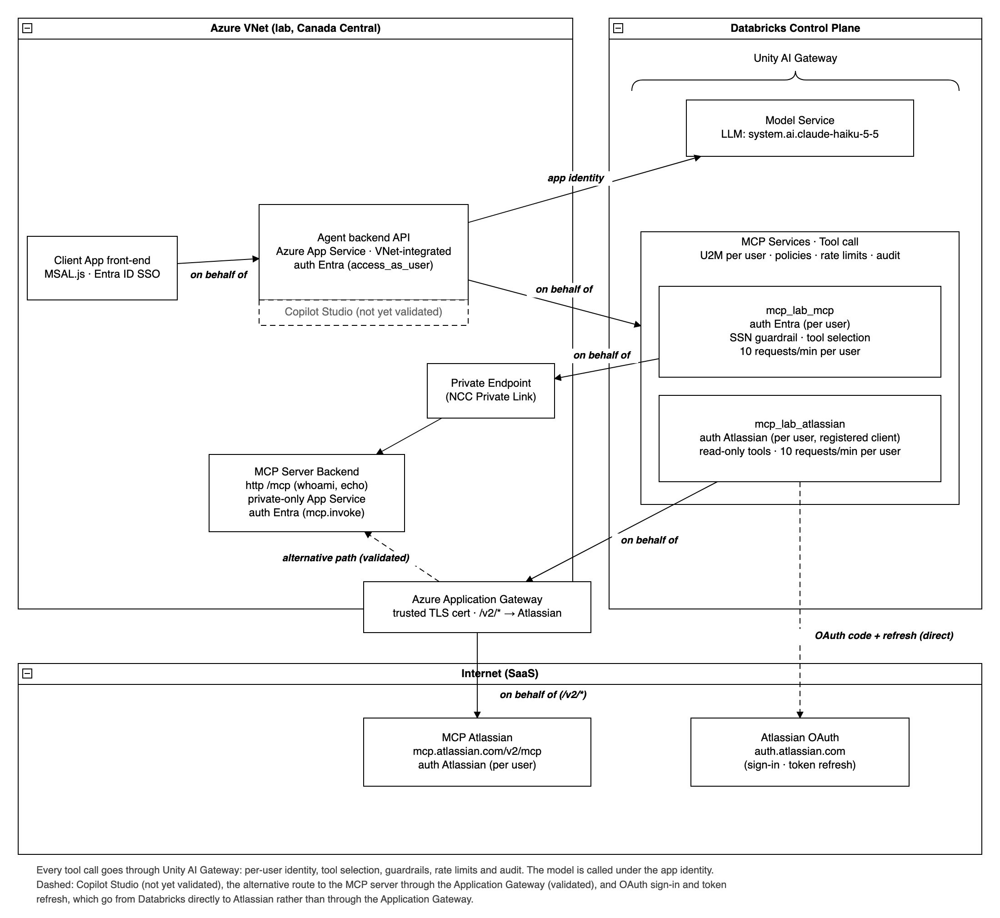

# Lab results: delegated user identity and central governance for agent tools with Databricks Unity AI Gateway

**Lab validation, November 2026**

## Summary

We built this pattern end to end in a Databricks lab on Azure (Canada Central), with synthetic data only. An Azure-hosted agent application signs users in with Microsoft Entra ID. It calls a large language model through Unity AI Gateway under the application's own identity. It calls MCP tools through Unity AI Gateway on behalf of the signed-in user, both for an Entra-protected MCP server inside an Azure VNet and for Atlassian's Rovo MCP server reached through an Azure Application Gateway.

Key answers:

1. **Is the pattern supported?** Yes, with one adjustment to the identity model. Unity AI Gateway centralizes access control, tool selection, guardrails, rate limits and audit for every tool call, and the user's identity is preserved at every hop. The gateway does **not** forward the user's inbound Entra token to the MCP server. Instead, each user grants a one-time, per-user credential for each MCP service. The gateway then calls the MCP server with that user's own token for that server, and refreshes it automatically.
2. **OAuth U2M Per User or dynamic client registration (DCR)?** **U2M Per User with a registered OAuth client** worked for both targets. For an Entra-protected MCP server, use an Entra app registration: Entra ID works with pre-registered applications rather than open dynamic registration. For Atlassian, a single registered client worked through the Application Gateway, which avoids depending on dynamic registration at run time.
3. **How does the app get a token for the gateway?** Both options worked: Entra on-behalf-of to Azure Databricks, and OAuth token federation (the app exchanges the user's token for a Databricks token).

## What we validated

| Capability | What we observed |
|---|---|
| Single Entra sign-in to the agent app | The browser signs in once (Entra SSO). |
| Tools called as the user | The internal MCP server received the user's own Entra token (correct audience and user). Atlassian returned the signed-in user's own Atlassian account. |
| LLM called as the application | The backend's service principal calls the model through a Unity AI Gateway model service. In `system.ai_gateway.usage`, MCP calls are recorded under each user (`USER`) and model calls under the app (`SERVICE_PRINCIPAL`). |
| Token federation | The user's Entra token, exchanged at `/oidc/v1/token`, gave a Databricks token for the same user (scope `all-apis`, about one hour). With it, MCP calls, the guardrail and tool selection behaved as with on-behalf-of. Tested with a federation policy for the Azure Databricks audience. |
| Central tool allow-listing | Tools that aren't selected aren't offered to the agent, and forced calls are rejected (error -32003). |
| Guardrail policy | A request containing a US Social Security Number was blocked before reaching the tool (error -32003). |
| Per-user rate limits | Calls beyond the configured per-user limit returned HTTP 429. |
| Private MCP server | The MCP server has public access disabled and is reached from Databricks serverless compute through Private Link (Network Connectivity Configuration). |
| Application Gateway path to Atlassian | Tool calls route through the Application Gateway to `mcp.atlassian.com`; the gateway's access logs show each request and its Atlassian backend. |
| Atlassian IP allowlisting | On an Atlassian site with IP allowlisting turned on, Jira refused the Rovo MCP data call that came through the Application Gateway ("You don't have permission to connect from this IP address"), because the gateway's IP wasn't on that site's allowlist. Sign-in, token exchange and site discovery still succeeded. |
| Silent Entra tool sign-in | The app ran the authorization code flow itself with `prompt=none` and handed the code to Databricks through the credential API (Beta). With an existing consent and an Entra session, the user saw no prompt. |
| Sign-out and disconnect | The app cleared its own cookies and storage and ended the Microsoft session. A separate action removed the user's tool sign-ins held by the gateway (credential API, Beta). |
| Credential lifecycle | A missing credential returns a sign-in link, re-sign-in is silent with SSO, and tokens refresh automatically (an Atlassian call succeeded 71 minutes after sign-in). |
| Agent using several MCP services at once | One chat used both the internal MCP server and Atlassian, with a separate sign-in per service. |

## How the flow works

1. The user signs in to the front-end with Entra ID. The front-end calls the agent backend with a token for the backend's API.
2. **Tools, as the user.** The backend gets an Azure Databricks token for the user (Entra on-behalf-of, or token federation) and calls the Unity AI Gateway MCP service. The gateway enforces tool selection, policies and rate limits. It then calls the MCP server with the user's own per-user credential for that server.
3. **LLM, as the application.** The backend uses its service principal (client credentials) to call the Unity AI Gateway model service.
4. **Networking.** Tool calls to the internal MCP server leave Databricks serverless compute through a private endpoint. Tool calls to Atlassian go through the Application Gateway. By default, OAuth sign-in and token refresh go directly to the identity provider (`login.microsoftonline.com`, `auth.atlassian.com`).

## Prerequisites checklist

**Microsoft Entra ID**
- An app registration for the agent backend API (scope for the front-end), with delegated permission to Azure Databricks if you use on-behalf-of. Grant tenant admin consent so users don't see consent prompts.
- An app registration exposing the MCP server's API (for example `mcp.invoke`), with an `https://` Application ID URI used as the OAuth resource.
- A separate app registration as the Unity AI Gateway connection's OAuth client. Using the MCP API app itself for this breaks token refresh.
- Redirect URIs for the connection client: `https://<workspace-host>/login/oauth/http.html` (and the account login host).

**Databricks**
- A workspace in a region that supports Model Serving, with Unity Catalog.
- For each MCP server: a Unity Catalog HTTP connection (OAuth U2M Per User) and an MCP service with tool selection, guardrail policies and rate limits.
- Callers need a workspace entitlement (for example Consumer access or Workspace access) in addition to workspace assignment. In our lab, the backend's service principal got HTTP 403 from the gateway until it had one, because the workspace's users group had no default entitlements. Check your workspace defaults for both the service principal and end users.
- `EXECUTE` on the MCP services and on the model service, plus `USE CATALOG` and `USE SCHEMA`.
- A Network Connectivity Configuration with a private endpoint rule for each private target (the MCP server or the Application Gateway).
- For token federation: an account federation policy whose issuer, audience and subject claim match the token your app receives.

**Azure Application Gateway**
- A publicly trusted TLS certificate on the listener the gateway calls. A self-signed or private-CA certificate fails.
- Path routing to each backend, with host-name override (for Atlassian: `mcp.atlassian.com`).
- **Restrict the listener's source.** A public listener that forwards to `mcp.atlassian.com` would let anyone with a valid Atlassian token use your egress IP. Use a private frontend reached through a private endpoint, or source rules.
- If the agent backend streams responses (SSE) through an Application Gateway or API gateway, disable response buffering.

**Atlassian**
- An OAuth client registered with Atlassian's MCP authorization server (read-only scopes are sufficient for search and read).
- If your Atlassian organization restricts client domains, allow the Databricks workspace host. For a sign-in that redirects back to your own app, also allow the app's domain.

## Limitations and caveats

- **No literal token passthrough.** Each user consents once per MCP service. With tenant admin consent and SSO, the Entra prompts disappear. The one-time Atlassian consent cannot be avoided, because Atlassian only accepts Atlassian-issued tokens and always shows its consent screen.
- **Start the gateway's per-user sign-in in a pop-up.** Use the MCP service's Login button in Catalog Explorer, or a pop-up from your app. A full-page redirect to the gateway's sign-in page completed the consent but did not store the credential. Browsers only open a pop-up from a user action, unless the site is allowed (browser setting or enterprise policy).
- **Redirect sign-in and the Atlassian domain allowlist.** An app-driven sign-in that returns to the app's own domain is blocked unless that domain is allowed in the Atlassian MCP server settings. The settings that apply are those of the Atlassian organization that manages the user's account.
- **Revocation is not instant.** After a credential is removed, the gateway may keep using it for a few minutes.
- **Replacing an OAuth client requires a new sign-in.** When we replaced the Atlassian OAuth client (new client ID), every existing per-user credential stopped working. Calls failed with a token-exchange error (-32603) rather than a sign-in link, until each user logged in again. Treat any OAuth client replacement as a user-visible change, and tell users how to sign in again.
- **The access logs show routing, not source IP.** With a public Application Gateway, backend connections leave from the gateway's public IP (Azure design), and the gateway adds an `X-Forwarded-For` header by default. If Atlassian IP allowlisting is the reason for the Application Gateway, add the gateway's public outbound IP to the allowlist, and confirm whether Atlassian evaluates the connection's source IP or the `X-Forwarded-For` header.
- **OAuth through the Application Gateway, partially.** Routing Atlassian's `/authorize` and `/oauth/token` through the gateway worked: the token exchange from Databricks went through it. The browser's login and consent pages still load directly from Atlassian, because Atlassian redirects to its own domain.
- **Generic tool errors.** When the provider reports a tool error, Unity AI Gateway returns a generic "external MCP tool failed" message. For example, Jira search needs a bounded JQL query (a project or a date), and the unbounded query failed with that message.
- **One identity for model spend.** LLM calls run under the application's identity, so model usage isn't attributed per user unless you add request tags or call the model per user.

## Not yet validated (open items)

- Token federation with a policy for the app's own API audience, which removes the on-behalf-of step and its consent.
- Token refresh through the Application Gateway, when the OAuth endpoints are routed through it.
- A private Application Gateway frontend reached through a private endpoint, and Entra-federated Atlassian sign-in.
- Atlassian IP allowlisting, allowed case: we observed the blocked case only. We haven't tested a call from an allowlisted Application Gateway IP, or which IP Atlassian evaluates.
- An AG-UI agent backend (the lab backend returns plain JSON) and Copilot Studio as a client.
- Private front-end connectivity to the workspace (requires a VNet-injected workspace).
- Tenant-specific policies (for example Conditional Access).

## Adopting the pattern

1. Review the prerequisites checklist with your Entra and network teams, and plan tenant admin consent for the backend app and for the connection's OAuth client.
2. Decide the Application Gateway topology (private frontend preferred) and how Atlassian allowlisting applies.
3. Choose the inbound option (on-behalf-of or token federation) and the sign-in experience (gateway pop-up or app-driven sign-in).
4. Pilot with a small group of users, using rate limits, tool selection and guardrails from day one.
