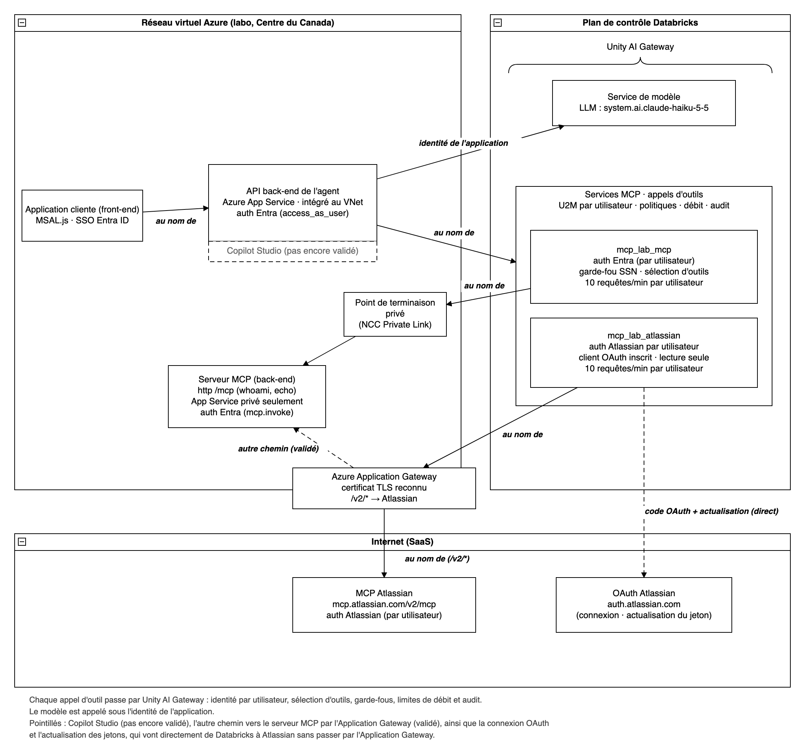

# Résultats du laboratoire : identité utilisateur déléguée et gouvernance centralisée des outils d'agent avec Databricks Unity AI Gateway

**Validation en laboratoire, novembre 2026**

## Sommaire

Nous avons reproduit ce patron de bout en bout dans un laboratoire Databricks sur Azure (Centre du Canada), avec des données synthétiques seulement. Une application d'agent hébergée dans Azure authentifie les utilisateurs avec Microsoft Entra ID. Elle interroge un grand modèle de langage (LLM) par l'entremise d'Unity AI Gateway, sous sa propre identité, et appelle des outils MCP par la même passerelle, au nom de l'utilisateur connecté. Les outils provenaient de deux serveurs MCP : un serveur protégé par Entra dans un réseau virtuel Azure, et le serveur Rovo MCP d'Atlassian, joint par une Azure Application Gateway.

Réponses principales :

1. **Le patron est-il pris en charge?** Oui, avec un ajustement au modèle d'identité. Unity AI Gateway centralise le contrôle d'accès, la sélection d'outils, les garde-fous, les limites de débit et l'audit pour chaque appel d'outil, et l'identité de l'utilisateur est préservée à chaque étape. La passerelle ne transmet **pas** le jeton Entra entrant de l'utilisateur au serveur MCP. Chaque utilisateur se connecte plutôt une fois à chaque service MCP. La passerelle conserve ensuite ses informations d'identification, appelle le serveur MCP avec un jeton émis pour cet utilisateur et l'actualise automatiquement.
2. **OAuth U2M Per User ou inscription dynamique de clients (DCR)?** **U2M Per User avec un client OAuth inscrit** a fonctionné pour les deux cibles. Pour un serveur MCP protégé par Entra, utilisez une inscription d'application Entra : Entra ID fonctionne avec des applications préinscrites plutôt qu'avec une inscription dynamique ouverte. Pour Atlassian, un seul client inscrit a fonctionné à travers l'Application Gateway, ce qui évite de dépendre de l'inscription dynamique au moment de l'exécution.
3. **Comment l'application obtient-elle un jeton pour la passerelle?** Les deux approches ont fonctionné : le flux On-Behalf-Of d'Entra vers Azure Databricks, et la fédération de jetons OAuth (l'application échange le jeton de l'utilisateur contre un jeton Databricks).

## Ce que nous avons validé

| Capacité | Ce que nous avons observé |
|---|---|
| Connexion Entra unique à l'application d'agent | L'utilisateur se connecte une seule fois (SSO Entra). |
| Outils appelés au nom de l'utilisateur | Le serveur MCP interne a reçu un jeton Entra émis pour l'utilisateur (bonne audience, bon utilisateur). Atlassian a renvoyé le compte Atlassian de l'utilisateur connecté. |
| LLM appelé sous l'identité de l'application | Le principal de service du back-end appelle le modèle par un service de modèle Unity AI Gateway. Dans `system.ai_gateway.usage`, les appels MCP sont enregistrés au nom de chaque utilisateur (`USER`) et les appels au modèle au nom de l'application (`SERVICE_PRINCIPAL`). |
| Fédération de jetons | Le jeton Entra de l'utilisateur, échangé à `/oidc/v1/token`, a donné un jeton Databricks pour le même utilisateur (étendue `all-apis`, environ une heure). Avec ce jeton, les appels MCP, le garde-fou et la sélection d'outils se sont comportés comme avec l'OBO. Testé avec une politique de fédération pour l'audience Azure Databricks. |
| Liste centralisée des outils autorisés | Les outils non sélectionnés ne sont pas proposés à l'agent, et les appels forcés sont rejetés (erreur -32003). |
| Politique de garde-fou | Une requête contenant un numéro de sécurité sociale américain a été bloquée avant d'atteindre l'outil (erreur -32003). |
| Limites de débit par utilisateur | Au-delà de la limite configurée pour chaque utilisateur, les appels ont reçu HTTP 429. |
| Serveur MCP privé | L'accès public au serveur MCP est désactivé. Le calcul sans serveur de Databricks le joint par Private Link (Network Connectivity Configuration). |
| Chemin vers Atlassian par l'Application Gateway | Les appels d'outils passent par l'Application Gateway jusqu'à `mcp.atlassian.com`. Les journaux d'accès de la passerelle montrent chaque requête et son back-end Atlassian. |
| Liste d'adresses IP autorisées d'Atlassian | Sur un site Atlassian où la liste d'adresses IP autorisées était activée, Jira a refusé l'appel de données Rovo MCP arrivé par l'Application Gateway (« You don't have permission to connect from this IP address »), car l'adresse IP de la passerelle ne figurait pas sur la liste de ce site. La connexion, l'échange de jeton et la découverte du site ont tout de même réussi. |
| Connexion silencieuse aux outils Entra | L'application a exécuté elle-même le flux de code d'autorisation avec `prompt=none`, puis a remis le code à Databricks par l'API d'informations d'identification (Bêta). Avec un consentement existant et une session Entra, l'utilisateur n'a vu aucune demande. |
| Déconnexion | L'application a effacé ses propres témoins et son stockage, puis a fermé la session Microsoft. Une action distincte a retiré les connexions aux outils conservées par la passerelle (API d'informations d'identification, Bêta). |
| Cycle de vie des informations d'identification | En l'absence d'informations d'identification, la passerelle renvoie un lien de connexion. La reconnexion est silencieuse avec le SSO, et les jetons s'actualisent automatiquement (un appel Atlassian a réussi 71 minutes après la connexion). |
| Agent utilisant plusieurs services MCP à la fois | Une même conversation a utilisé le serveur MCP interne et Atlassian, avec une connexion distincte par service. |

## Fonctionnement du flux

1. L'utilisateur se connecte au front-end avec Entra ID. Le front-end appelle le back-end de l'agent avec un jeton destiné à l'API du back-end.
2. Pour les outils, le back-end obtient un jeton Azure Databricks pour l'utilisateur (flux On-Behalf-Of d'Entra, ou fédération de jetons), puis appelle le service MCP d'Unity AI Gateway. La passerelle applique la sélection d'outils, les politiques et les limites de débit. Elle appelle ensuite le serveur MCP avec les informations d'identification propres à l'utilisateur pour ce serveur.
3. Pour le LLM, le back-end utilise son propre principal de service (informations d'identification du client) pour appeler le service de modèle d'Unity AI Gateway.
4. Côté réseau, les appels d'outils vers le serveur MCP interne sortent du calcul sans serveur de Databricks par un point de terminaison privé. Les appels d'outils vers Atlassian passent par l'Application Gateway. Par défaut, la connexion OAuth et l'actualisation des jetons vont directement au fournisseur d'identité (`login.microsoftonline.com`, `auth.atlassian.com`).

## Liste de vérification des prérequis

**Microsoft Entra ID**
- Une inscription d'application pour l'API back-end de l'agent (avec une étendue pour le front-end), et une autorisation déléguée vers Azure Databricks si vous utilisez l'OBO. Accordez le consentement administrateur du locataire : les utilisateurs n'auront alors aucune demande de consentement à traiter.
- Une inscription d'application qui expose l'API du serveur MCP (par exemple `mcp.invoke`), avec un URI d'ID d'application en `https://` utilisé comme ressource OAuth.
- Une inscription d'application distincte, qui sert de client OAuth à la connexion Unity AI Gateway. Réutiliser l'application de l'API MCP pour ce rôle empêche l'actualisation des jetons.
- Des URI de redirection pour le client de la connexion : `https://<workspace-host>/login/oauth/http.html` (ainsi que l'hôte de connexion du compte).

**Databricks**
- Un espace de travail dans une région qui prend en charge Model Serving, avec Unity Catalog.
- Pour chaque serveur MCP : une connexion HTTP Unity Catalog (OAuth U2M Per User) et un service MCP avec sélection d'outils, politiques de garde-fou et limites de débit.
- En plus d'être affectés à l'espace de travail, les appelants ont besoin d'un droit sur celui-ci (par exemple Consumer access ou Workspace access). Dans notre laboratoire, le principal de service du back-end a reçu HTTP 403 de la passerelle tant qu'il n'avait pas ce droit, parce que le groupe des utilisateurs de l'espace de travail n'avait aucun droit par défaut. Vérifiez les valeurs par défaut de votre espace de travail, pour le principal de service comme pour les utilisateurs finaux.
- `EXECUTE` sur les services MCP et sur le service de modèle, ainsi que `USE CATALOG` et `USE SCHEMA`.
- Une Network Connectivity Configuration avec une règle de point de terminaison privé pour chaque cible privée (le serveur MCP ou l'Application Gateway).
- Pour la fédération de jetons : une politique de fédération du compte dont l'émetteur, l'audience et la revendication sujet correspondent au jeton que reçoit votre application.

**Azure Application Gateway**
- Un certificat TLS reconnu publiquement sur l'écouteur qu'appelle Unity AI Gateway. Un certificat autosigné ou émis par une autorité de certification privée ne fonctionne pas.
- Un routage par chemin vers chaque back-end, avec remplacement du nom d'hôte (pour Atlassian : `mcp.atlassian.com`).
- **Restreignez la source de l'écouteur.** Un écouteur public qui relaie vers `mcp.atlassian.com` permettrait à quiconque détient un jeton Atlassian valide d'utiliser votre adresse IP de sortie. Utilisez un front-end privé joint par un point de terminaison privé, ou des règles de filtrage des sources.
- Si le back-end de l'agent diffuse ses réponses en continu (SSE) à travers une Application Gateway ou une passerelle d'API, désactivez la mise en mémoire tampon des réponses.

**Atlassian**
- Un client OAuth inscrit auprès du serveur d'autorisation MCP d'Atlassian. Des étendues en lecture seule suffisent pour la recherche et la lecture.
- Si votre organisation Atlassian restreint les domaines des clients, autorisez l'hôte de l'espace de travail Databricks. Pour une connexion qui revient vers votre propre application, autorisez aussi le domaine de l'application.

## Limites et mises en garde

- **Pas de transmission directe du jeton.** Chaque utilisateur donne son consentement une fois par service MCP. Avec le consentement administrateur du locataire et le SSO, les demandes de consentement Entra disparaissent. Le consentement Atlassian initial, lui, ne peut pas être évité : Atlassian n'accepte que ses propres jetons et affiche toujours son écran de consentement.
- **Lancez la connexion par utilisateur du gateway dans une fenêtre contextuelle.** Utilisez le bouton Login du service MCP dans Catalog Explorer, ou une fenêtre contextuelle ouverte par votre application. Une redirection pleine page vers la page de connexion du gateway a bien enregistré le consentement, mais pas les informations d'identification. Les navigateurs n'ouvrent une fenêtre contextuelle qu'à la suite d'une action de l'utilisateur, sauf si le site est autorisé (paramètre du navigateur ou politique d'entreprise).
- **Connexion par redirection et liste de domaines d'Atlassian.** Une connexion pilotée par l'application qui revient vers le domaine de l'application est bloquée tant que ce domaine n'est pas autorisé dans les paramètres du serveur MCP d'Atlassian. Les paramètres qui s'appliquent sont ceux de l'organisation Atlassian qui gère le compte de l'utilisateur.
- **La révocation n'est pas instantanée.** Après la suppression des informations d'identification, la passerelle peut continuer à les utiliser pendant quelques minutes.
- **Le remplacement d'un client OAuth exige une nouvelle connexion.** Quand nous avons remplacé le client OAuth Atlassian (nouvel identifiant de client), toutes les informations d'identification par utilisateur existantes ont cessé de fonctionner. Jusqu'à ce que chaque utilisateur se reconnecte, les appels échouaient avec une erreur d'échange de jeton (-32603) plutôt qu'avec un lien de connexion. Planifiez donc tout remplacement de client OAuth comme un changement visible, et prévoyez des instructions de reconnexion pour les utilisateurs.
- **Les journaux d'accès montrent le routage, pas l'adresse IP source.** Avec une Application Gateway publique, les connexions vers les back-ends partent de l'adresse IP publique de la passerelle (comportement normal d'Azure), et la passerelle ajoute par défaut un en-tête `X-Forwarded-For`. Si l'Application Gateway sert à respecter la liste d'adresses IP autorisées d'Atlassian, ajoutez-y l'adresse IP publique de sortie de la passerelle, et vérifiez si Atlassian évalue l'adresse IP source de la connexion ou l'en-tête `X-Forwarded-For`.
- **OAuth par l'Application Gateway, en partie.** Acheminer `/authorize` et `/oauth/token` d'Atlassian par la passerelle a fonctionné : l'échange de jeton de Databricks est passé par elle. Les pages de connexion et de consentement se chargent quand même directement depuis Atlassian dans le navigateur, parce qu'Atlassian redirige vers son propre domaine.
- **Erreurs d'outils génériques.** Quand le fournisseur signale une erreur d'outil, Unity AI Gateway renvoie un message générique « external MCP tool failed ». Par exemple, la recherche Jira exige une requête JQL bornée (un projet ou une date), et la requête non bornée a échoué avec ce message.
- **Une seule identité pour la consommation du modèle.** Les appels au LLM s'exécutent sous l'identité de l'application. L'utilisation du modèle n'est donc pas attribuée par utilisateur, à moins d'ajouter des étiquettes aux requêtes ou d'appeler le modèle au nom de chaque utilisateur.

## Pas encore validé (points ouverts)

- La fédération de jetons avec une politique pour l'audience de l'API de l'application, qui retire l'étape OBO et son consentement.
- L'actualisation des jetons par l'Application Gateway, quand les points de terminaison OAuth y sont acheminés.
- Un front-end privé d'Application Gateway joint par un point de terminaison privé, et la connexion Atlassian fédérée avec Entra.
- Liste d'adresses IP autorisées d'Atlassian, cas autorisé : nous avons seulement observé le cas bloqué. Nous n'avons pas testé d'appel provenant d'une adresse IP d'Application Gateway autorisée, ni vérifié quelle adresse IP Atlassian évalue.
- Un back-end d'agent AG-UI (le back-end du laboratoire renvoie du JSON simple), et Copilot Studio comme client.
- La connectivité privée du front-end vers l'espace de travail (exige un espace de travail injecté dans un VNet).
- Les politiques propres à chaque locataire (par exemple l'accès conditionnel).

## Adopter le patron

1. Passer en revue la liste de vérification des prérequis avec vos équipes Entra et réseau, et planifier le consentement administrateur du locataire pour l'application back-end et pour le client OAuth de la connexion.
2. Choisir la topologie de l'Application Gateway (front-end privé de préférence) et déterminer comment s'applique la liste d'adresses IP autorisées d'Atlassian.
3. Choisir l'approche d'entrée (OBO ou fédération de jetons) et l'expérience de connexion (fenêtre contextuelle du gateway ou connexion pilotée par l'application).
4. Mener un projet pilote auprès d'un petit groupe d'utilisateurs, en activant dès le départ les limites de débit, la sélection d'outils et les garde-fous.
